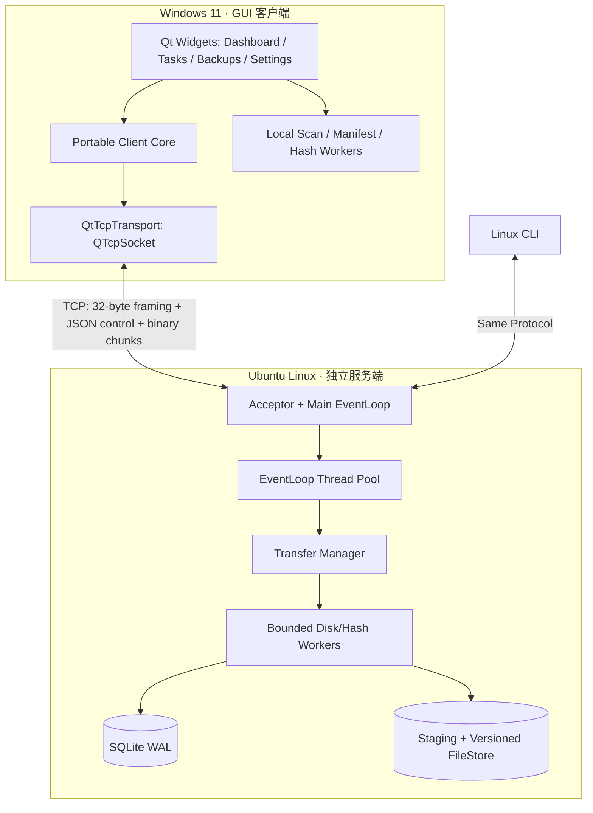

# ChunkHarbor — Codex 完整开发指南（Windows Qt + Linux Reactor）

> **项目定位**：面向个人代码、文档与大型数据集的跨平台增量备份系统；核心是自主实现的 Linux C++ `epoll` / Reactor 服务器，以及 Windows Qt Widgets 图形客户端。  
> **交付组成**：`chunkharbor-server`（Linux）、`chunkharbor-cli`（Linux）、`chunkharbor-gui`（Windows，后续可编译至 Linux）、共享跨平台协议库。  
> **主要语言与技术**：C++17、Qt 6 Widgets / Qt Network、Linux TCP/epoll、CMake、SQLite、OpenSSL EVP。  
> **建议开发环境**：Windows 11 + Qt 6.8.x / MinGW 13.x + Ubuntu 22.04 虚拟机（服务端不依赖 Qt）。  
> **质量原则**：可复现构建 → 正确性 → 可恢复性 → 可观测性 → 性能 → 扩展功能。  
> **状态声明**：本文仅为设计与验收规范，**不代表任何功能已经开发、测试或达到性能目标**。  
> **版本**：2026-10-30（重新生成与路线补充）；**首个交付目标**：可信开发环境下的单向备份 MVP。**用户已告知第一阶段完成，但本指南不假设任何具体代码或测试结果。**

---

## 0. 给 Codex 的最高优先级指令（务必先读）

你是 ChunkHarbor 仓库的 **C++ / Linux 系统工程开发伙伴**。请阅读根目录 `AGENTS.md` 与本指南，先了解工程状态再改代码。目标不是一次生成庞大工程，而是以可运行、可测试的增量开发方式构建真正可靠的系统。

1. **先检查再修改**：阅读 `AGENTS.md`、`README.md`、本指南、`docs/PROGRESS.md`（若存在）、当前 CMake / 源码、`git status`。
2. **每轮一个可测试子任务**：遵循 M0–M7；“继续”表示先检查当前已有提交与实际测试证据，从完成的位置推进下一最小任务。用户已报告完成一阶段，**禁止重新初始化、覆盖已有工程或无理由重做已完成代码**。
3. **开发前计划**：简述目标、文件、接口与线程归属、失败路径、测试和兼容性；没有必要不引入新框架。
4. **跨平台边界从 M0 固化**：Linux-only 的 `epoll` / `openat` / `eventfd` 绝不能编译进 Windows GUI；共享 `protocol` / `client_core` 使用 C++17、没有 Qt GUI 与 Linux 系统调用依赖。
5. **服务端独立于 Qt**：Linux Server 用自主 Reactor；Qt GUI 通过 `QTcpSocket` 连接，同一二进制协议的编码解码由共享 C++ 协议库负责。
6. **线程纪律**：EventLoop 不做阻塞磁盘操作、SHA-256 大文件计算、数据库事务；Qt 主线程不做目录全量扫描、文件读取哈希或其他长任务。工作完成后正确投递回对应线程。
7. **每次修改后实际验证**：对应平台构建、CTest、相关集成 / GUI 测试；未能执行 Windows 测试必须明确写“未验证”，不能推断成功。
8. **真实可靠性**：不能把 TCP 自动重连描述为断点续传；不能把固定块比较描述为 rsync rolling checksum；SQLite 与文件系统不是一个原子事务。
9. **安全**：默认仅监听 `127.0.0.1`；Windows→Ubuntu 可使用 SSH 隧道做可信开发测试。未完成 TLS + 认证/授权前，不得向不可信网络开放服务。
10. **数据保护**：不删除或覆盖真实用户数据，不自动 `git push`，不用用户真实文档目录做破坏性测试；服务端路径必须受根目录约束，拒绝目录穿越与符号链接逃逸。
11. **汇报**：用中文交付变更文件、实际运行命令和结果、未验证项、已知问题和下一步，同时更新 `docs/PROGRESS.md`。
12. **保持诚实**：功能未实现、仅有架构草图、或只在 Ubuntu 上验证时必须写清楚；不编造性能数据、没有证据不宣称零拷贝加速或稳定高并发。

### v1 明确范围（不随意扩张）

- **实现**：从 Windows/Ubuntu 客户端向 Linux 服务器进行单向备份，支持完整上传、断点续传、固定块增量、目录批任务；有界并发、可恢复元数据、下载恢复和简洁 Qt GUI。
- **不做**：双向实时同步、自动合并冲突、企业多租户云盘、P2P、Raft、分布式集群、任意远程命令执行、虚构的“端到端零拷贝”。
- **GUI 从设计之初被考虑**：M2 基础上传验证后允许建立最小 Qt GUI 骨架与连接状态原型；M5 才完成任务管理和跨平台端到端上传。提前做 GUI 不得牺牲 Linux Reactor 学习和可靠性测试。

---

## 1. 项目背景、真实应用与范围

### 1.1 用户故事

开发者在 Windows 11 上维护 C++ 项目、文档、照片和大型研究数据，Ubuntu 虚拟机或实体 NAS 负责持续保存备份。Qt 客户端展示连接状态、备份任务、文件变化量、上传进度、失败原因和历史版本。用户无需理解 TCP 协议就可以选择文件夹并启动备份。

- 第一次备份：扫描目录 → 创建任务 → 上传文件 → 校验 → 提交。
- 第二次备份：比较已提交版本的同位置固定分块 SHA-256，仅上传不同块；无变化文件应跳过数据块传输。
- 连接断开：重连后根据本地记录的会话与服务器确认的持久化块集合恢复；不把内存中进度当作服务端已落盘确认。
- 服务器意外终止：重启后恢复合法会话，检查临时数据、数据库状态与发布状态；客户端可以重新查询缺失块。
- 用户恢复：从服务器列举已提交文件并将其下载至明确选定的本地目录，校验整文件哈希。

### 1.2 v1 功能与边界

1. Windows Qt Widgets GUI 是主要用户入口；Linux CLI 是开发、自动化和无 GUI 环境入口。
2. Linux `chunkharbor-server` 是真正的网络与文件存储后端，自主 `epoll` Reactor，独立进程运行。
3. 客户端只备份到服务端，不直接修改源文件；第一版只提供**单向备份**，不是自动双向同步。
4. 支持手动目录扫描 / 备份；`QFileSystemWatcher` 自动监控、计划任务、托盘模式作为后期可选需求。
5. 初期可信本地或 SSH 转发开发；TLS + 身份鉴权之前不面向互联网部署。

### 1.3 非功能性目标

- **正确性**：公开可下载的文件必须是经过整文件校验的已提交版本；不能把暂存数据展示为成功。
- **恢复性**：对断连、客户端重启、服务端崩溃和重复消息定义明确的语义与可复现测试。
- **稳定性**：有界工作队列、内存缓存、连接资源；慢客户端不得导致持续无界增长。
- **安全性**：服务端明确备份根目录、抵御路径穿越/符号链接攻击；客户端只能恢复到用户明确允许的位置。
- **可观测性**：日志、错误码、事件循环负载、吞吐量和真实传输字节统计；GUI 指标与服务端协议状态一致。
- **学习与简历价值**：所有技术点必须有代码、测试与实测证据，不为凑技术栈引入不必要的组件。

---

## 2. 技术栈、平台约束与方案取舍

| 层次 | 技术 / 平台 | 决策理由及边界 |
|---|---|---|
| C++ 基线 | **C++17** | 一套语言标准，模块之间便于复用；Qt GUI 不依赖 C++20 才有的接口 |
| Linux Server | Ubuntu 22.04+、POSIX sockets、`epoll`、`eventfd` | 自主实现 LT Reactor，之后可独立研究 ET；服务器不依赖 Qt |
| Windows GUI | Qt 6 Widgets、Qt Network、Qt Test | `QMainWindow` / `QTableView` + `QTcpSocket`，保持界面响应性 |
| Linux CLI | 自定义轻量 CLI / POSIX TCP 适配层 | 便于协议调试、自动化和故障注入；不要求同时实现 Windows CLI |
| 跨平台共享库 | `protocol`、`client_core`、`common_portable` | 纯 C++17，禁止依赖 `epoll` / Linux FD；不直接调用 `QTcpSocket` |
| 传输 | 32 字节固定帧头 + JSON 控制消息 + 二进制 DATA_CHUNK | 避免结构体 ABI、字节序和 Qt 序列化差异 |
| 哈希 | OpenSSL EVP / SHA-256 | 块与整文件校验；不自行实现加密哈希 |
| 存储 | SQLite WAL + Linux 文件系统 | 记录版本、块状态、上传会话；文件发布使用独立恢复协议 |
| 并发 | one-loop-per-thread + 有界磁盘执行器 | 网络、磁盘、哈希/数据库与 GUI 线程职责分离 |
| 构建 | CMake 3.20+ / Ninja (Linux) / 兼容的 Qt MinGW 或 MSVC Kit (Windows) | 不混用编译器 ABI；按平台启用独立可执行 target |
| 测试 | CTest、C++ 单测、Python 集成/故障注入、Qt Test | Linux 后端、协议库、Windows GUI 分别验收 |
| 观测 | 结构化日志、`perf`、ASan/UBSan/TSan | 性能数据必须明确平台、样本、命令与测量条件 |

### 2.1 哪些代码可以跨平台共享？

**必须可移植**：帧编码/解析、报文类型、校验逻辑、路径逻辑名规范、任务与传输状态模型、客户端传输编排（通过抽象网络/文件接口）。使用固定宽度整数、显式大端序，禁止序列化 `std::string`/Qt 对象内存布局。

**仅 Linux**：`epoll`、`eventfd`、`accept4`、FD 及 `openat/openat2` 文件安全操作、SQLite 服务端落盘流程。

**仅 Qt 适配层**：`QTcpSocket`/`QAbstractSocket`、Qt signal/slot、`QFileDialog`、`QAbstractTableModel`、`QThreadPool`、窗口样式和系统托盘（可选）。不要在 `protocol` 包中引用 Qt 头文件。

### 2.2 Windows 编译器的注意事项

安装的 Qt 二进制包与编译器必须匹配。例如 Qt 6.8.x 的 MinGW Kit 应使用兼容版本 MinGW，不能用 MSVC 直接链接 MinGW 编译的 Qt 库；使用 `CMAKE_PREFIX_PATH` 指向实际 Qt Kit。GUI 使用 `WIN32` app target 可以关闭多余的控制台窗口（开发时允许保留便于调试）。

**默认开发策略**：Linux CI 必须能在**没有 Qt** 的环境中配置、编译、测试后端；Windows GUI 构建仅在显式启用并找到 Qt 6 时进行，避免服务端被 GUI 依赖拖累。

---

## 3. 推荐仓库目录与 CMake targets

**渐进创建目录**，M0 只创建当前需要的最小骨架，不一次性建大量空文件。

```text
ChunkHarbor/
├── AGENTS.md
├── CODEX_DEVELOPMENT_GUIDE.md
├── README.md
├── CMakeLists.txt
├── CMakePresets.json                 # 可选：linux-debug / linux-asan / windows-gui
├── .clang-format
├── .gitignore
├── cmake/
├── configs/
│   ├── server.example.json
│   └── client.example.json
├── include/chunkharbor/
│   ├── protocol/                     # 纯 C++17，跨平台共享
│   │   ├── Frame.h
│   │   ├── FrameCodec.h
│   │   ├── Messages.h
│   │   └── ProtocolError.h
│   ├── client_core/                  # 纯 C++17 客户端任务模型/协议编排
│   │   ├── ClientSession.h
│   │   ├── TransferPlan.h
│   │   ├── ManifestBuilder.h
│   │   └── ClientTransferState.h
│   ├── common/                       # 可移植部分（哈希/错误码/日志 API）
│   ├── net/                          # Linux-only Reactor
│   │   ├── EventLoop.h
│   │   ├── Channel.h
│   │   ├── EpollPoller.h
│   │   ├── TcpConnection.h
│   │   ├── TcpServer.h
│   │   ├── Buffer.h
│   │   └── EventLoopThreadPool.h
│   ├── concurrency/                  # Linux Server 有界工作执行器
│   ├── transfer/                     # Server 会话状态机、块调度
│   └── storage/                      # Server FileStore / SQLite / 安全路径
├── src/
│   ├── protocol/
│   ├── client_core/
│   ├── common/
│   ├── net/
│   ├── concurrency/
│   ├── transfer/
│   └── storage/
├── apps/
│   ├── server/main.cpp               # Linux chunkharbor-server
│   ├── cli/main.cpp                  # Linux chunkharbor-cli
│   └── gui/                          # Qt 6 Widgets，Windows 优先
│       ├── main.cpp
│       ├── MainWindow.h
│       ├── MainWindow.cpp
│       ├── pages/                     # Dashboard / Tasks / Backups / Settings
│       ├── models/                    # TasksModel / BackupsModel
│       ├── services/                  # QtTcpTransport / TransferController
│       ├── widgets/
│       └── resources/
├── tests/
│   ├── unit/                         # 纯 C++ 单元测试、网络测试
│   ├── integration/                  # 协议、文件、目录批任务
│   ├── fault/                        # 崩溃、断网、损坏与重复操作
│   ├── gui/                          # Qt Test + 假 Transport
│   └── fixtures/
├── benchmarks/
│   ├── README.md
│   └── results/                      # 原始数据可按大小忽略 git
├── scripts/
├── packaging/                        # M7 Windows 部署 / Linux systemd
└── docs/
    ├── PROGRESS.md
    ├── ARCHITECTURE.md
    ├── PROTOCOL.md
    ├── CONSISTENCY.md
    ├── GUI_DESIGN.md
    ├── BUILD_WINDOWS.md
    ├── SECURITY.md
    ├── TEST_PLAN.md
    └── BENCHMARKS.md
```

### 3.1 建议的 CMake targets（名称保持稳定）

| target | 平台 | 依赖 | 用途 |
|---|---|---|---|
| `chunkharbor_protocol` | Linux / Windows | C++17 | 帧协议、控制消息序列化，独立测试 |
| `chunkharbor_client_core` | Linux / Windows | protocol、可移植 common | 客户端状态机、上传计划、校验与进度事件 |
| `chunkharbor_linux_net` | Linux | Linux 系统调用 | 自主实现 `epoll` Reactor |
| `chunkharbor_server_core` | Linux | net、protocol、SQLite、OpenSSL | FileStore、状态机与业务路由 |
| `chunkharbor-server` | Linux | server_core | 长期运行的独立服务端 |
| `chunkharbor-cli` | Linux | client_core | 本地测试、脚本与自动化 |
| `chunkharbor-gui` | Windows / Linux（有 Qt 6） | client_core、Qt6::Widgets、Qt6::Network | Qt 图形客户端 |

推荐的顶层选项：`CHUNKHARBOR_BUILD_SERVER`、`CHUNKHARBOR_BUILD_CLI`、`CHUNKHARBOR_BUILD_GUI`、`CHUNKHARBOR_BUILD_TESTS`。不同平台默认值需在 CMake 和 README 中注明。CMake 必须利用平台判断阻止 Windows 编译 Linux-only target。

### 3.2 依赖方向与层次纪律

- GUI → `client_core` → `protocol`；不允许 GUI → Linux `net`/`storage`。
- Linux CLI → `client_core` → `protocol`；避免 Qt 变成 CLI 强制依赖。
- Server → Linux `net` + `transfer` + `storage` + `protocol`；服务器不链接 Qt。
- `protocol` 不关心 UI、磁盘路径或业务 SQL，解析层不信任长度与标志字段。
- 每个 target 显式设置 `target_link_libraries` 与 include，避免全局污染；单元测试应可单独构建。

---

## 4. 系统架构与运行机制

### 4.1 实际部署：Windows 客户端 + Ubuntu 服务端



这表示**两个进程**、可处于两套操作系统：Windows 启动 `ChunkHarbor.exe`；Ubuntu 运行 `chunkharbor-server`。GUI 不直接访问 Ubuntu 文件系统，也不在 Windows 上执行 `epoll`。TCP 两端只需要一致的协议与字节序。

**开发网络推荐**：服务器监听 Ubuntu 内部的 `127.0.0.1:8787`，Windows 使用 SSH 本地端口转发至该端口；在完成 TLS + 身份鉴权前不要把未经保护的服务器端口暴露给公共网络。

### 4.2 一次备份的完整业务流程

1. Linux Server 启动 → 创建数据目录、加载 SQLite、检查不完整会话、初始化有界执行器、启动 Reactor 监听。
2. Windows 用户打开 GUI → 填写服务器地址（若走 SSH 隧道则为 `127.0.0.1:18787`）→ 点击连接；`QTcpSocket` 非阻塞连接 → `HELLO/HELLO_ACK` 协商协议版本。
3. 用户选择本地目录 → 工作线程进行目录枚举、文件大小/mtime/哈希检查；GUI 只展示进度和失败信息，不做耗时遍历。
4. 对每个文件：`BEGIN_UPLOAD`；全量上传返回缺失块列表，M4 以后通过分页 manifest 比对形成增量计划。向服务端传 `DATA_CHUNK`，经服务端校验、写入并持久化之后收到 `CHUNK_ACK`。
5. 所有需传块被确认后发 `COMMIT_UPLOAD`；服务端补全未变化块、校验整文件哈希、原子发布新版本并更新元数据；发送 `COMMIT_RESULT`。
6. GUI 进度**区分**“已读取/已发送/服务端已确认/已提交”，只有成功 `COMMIT_RESULT` 才显示“备份成功”。
7. TCP 断开时 GUI 展示“连接断开/等待恢复”，本地保存任务与 session 元数据；重连后 `QUERY_SESSION` 得到服务端真实缺失块再重试。
8. 用户恢复文件时执行 `LIST_FILES / BEGIN_DOWNLOAD / DOWNLOAD_CHUNK`，客户端下载至临时文件，SHA-256 验证成功后再发布到用户明确选定的本地路径。

### 4.3 Linux Reactor 核心组件

**EventLoop**
- 一个线程拥有一个 EventLoop，使用 `epoll_wait` 处理事件；`eventfd` 负责跨线程投递并唤醒。
- `runInLoop`、`queueInLoop`、`loop`、`quit` 需要明确关闭顺序和并发语义；处理 `EINTR` 不忙轮询。

**Channel / EpollPoller**
- Channel 持有一个 FD 的事件订阅与回调，但 FD 所有权由连接或 Acceptor 负责；防止回调内销毁造成悬空指针。
- Poller 管理 add/mod/del，先实现 LT，再测试 ET；非阻塞操作正确处理 `EINTR`、`EAGAIN`、对端半关闭。

**TcpConnection / TcpServer**
- TCP 是字节流；读取可能半包/粘包，发送可能部分写；必须支持有界缓冲、按需启停 EPOLLOUT 与背压。
- 主 Loop accept、IO Loops 管理各自连接，关闭状态和 pending 回调不得访问已释放对象。
- 服务端网络线程不做 SQLite 写事务或文件哈希；使用 BoundedExecutor，结果以队列投递回连接的所属 loop。

### 4.4 Qt GUI 的界面结构（M2 可做最小原型；M5 完整实现）

采用 **Qt 6 Widgets**，建议简洁的导航侧栏 + 主区域，不强制 QML。

| 页面 | 主要功能 | 关键 Widget / Model |
|---|---|---|
| 总览 Dashboard | 服务器连接状态、最近备份、已完成与失败数量、实时速率 | `QWidget`、状态卡片、进度控件 |
| 备份任务 Tasks | 添加本地文件/目录、启动/暂停/取消、任务详情、分块进度 | `QTableView` + `QAbstractTableModel`、`QProgressBar` |
| 备份预览 Preview | 新增、修改、未变文件、预估传输量、排除规则效果 | 只读差异模型、显式确认上传（M4/M5） |
| 已备份文件 Backups | 服务器文件列表、校验信息、下载恢复 | 分页列表、文件选择对话框（M6） |
| 历史版本 History | 可浏览的备份快照、恢复指定版本（需真正实现后启用） | 快照列表、版本详情（P1 可选） |
| 设置 Settings | 地址/端口、最大并发、带宽限制、备份默认目录、日志 | `QFormLayout`、`QSettings`（非机密配置） |
| 日志 / 详情 | 错误码、可复制日志、当前会话状态 | 日志视图，默认隐藏敏感信息 |

**建议 Qt 类划分**：`MainWindow` 只组装页面；`TasksModel` 与 `BackupsModel` 只管理展示数据；`TransferController` 封装用户动作和状态事件；`QtTcpTransport` 适配 `QTcpSocket` → `client_core`，由 `FrameCodec` 做增量解析。不要在 MainWindow 内直接写复杂 socket / SQL / 文件 I/O 逻辑。

**Qt 线程与生命周期硬约束**：
- `QTcpSocket` 在其所属线程创建、使用和销毁（GUI 初版可放主事件循环，非阻塞）；不要跨工作线程直接读写它。
- 扫描目录、块哈希和大文件读写放工作线程，完成后通过 queued signal / `QMetaObject::invokeMethod` 等安全投递回 GUI / 网络对象所属线程。
- 进度更新须节流（例如每 100–250 ms 聚合）以避免大量信号影响 UI；节流周期为初始建议，需实际测量。
- 取消要有可观测状态，从用户取消 → 停止生产新块 → 处理在途 ACK → 释放资源；不能仅调用 `thread->terminate()`。
- 任务状态由控制器统一维护，页面只订阅状态；程序退出时保存可恢复任务元数据，网络与线程按顺序停止。

### 4.5 用户能看到的任务状态

`QUEUED → SCANNING → CONNECTING → TRANSFERRING → VERIFYING → COMMITTING → COMPLETED`；失败分 `PAUSED / RETRYABLE_ERROR / FATAL_ERROR / CANCELED`。这是**客户端 UI 任务状态**，不同于服务端 Session 的持久化状态机；映射关系必须在 `docs/GUI_DESIGN.md` 明确写出。

只允许将**服务端已确认块**计入“可靠完成字节”，不能用 `QTcpSocket::bytesWritten` 或 OS socket 缓冲已接收字节当作数据已经被服务器持久化。

---

## 5. 自定义通信协议 v1（实现必须与 `docs/PROTOCOL.md` 一致）

### 5.1 固定帧头：32 字节，网络字节序（big-endian）

| 字段 | 类型 | 字节 | 说明 |
|---|---|---:|---|
| magic | uint32 | 4 | 固定 `0x43484B48`，ASCII `CHKH` |
| version | uint16 | 2 | 协议版本，初始为 `1` |
| type | uint16 | 2 | 消息类型 |
| flags | uint32 | 4 | 默认 `0`，未知标志拒绝 |
| request_id | uint64 | 8 | 请求关联标识，`0` 保留给无需关联的通知 |
| payload_length | uint64 | 8 | 负载长度，严格检验上限 |
| reserved | uint32 | 4 | 必须为 `0`，留待扩展 |
| **总计** | | **32** | **必须手动按字节序编码/解码，禁止直接传输结构体内存布局** |

**限制**：控制 JSON 消息最大 **64 KiB**；单条 `DATA_CHUNK` 消息总 payload 最大 **1 MiB**；默认数据块大小 **256 KiB**。所有长度检查必须在内存分配前执行。超限报错并关闭连接或拒绝请求，不得直接根据客户端声称的长度无限分配。

### 5.2 消息类型（初期建议编号）

| 编号 | 名称 | 方向 | 用途 |
|---:|---|---|---|
| 1 | HELLO | C→S | 协商版本、客户端信息 |
| 2 | HELLO_ACK | S→C | 协商结果、服务器能力 |
| 3 | BEGIN_UPLOAD | C→S | 声明相对路径、文件大小、mtime、分块尺寸、整文件 SHA-256 |
| 4 | UPLOAD_PLAN | S→C | 返回 session_id、需要上传的块序号/范围 |
| 5 | DATA_CHUNK | C→S | 发送原始块数据 |
| 6 | CHUNK_ACK | S→C | 确认某个块经校验并已达到约定持久化语义 |
| 7 | QUERY_SESSION | C→S | 查询未完成会话及缺失块 |
| 8 | SESSION_STATUS | S→C | 返回已确认块或尚缺失块 |
| 9 | COMMIT_UPLOAD | C→S | 请求验证整文件并发布 |
| 10 | COMMIT_RESULT | S→C | 成功 / 失败及原因 |
| 11 | LIST_FILES | C→S | 列举授权路径的备份文件元信息 |
| 12 | FILES_RESULT | S→C | 返回文件列表（限制分页/大小） |
| 13 | BEGIN_DOWNLOAD | C→S | 启动恢复下载 |
| 14 | DOWNLOAD_CHUNK | S→C | 下载数据块 |
| 15 | ERROR | 双向 | 协议或业务错误，包含稳定 error code |
| 16 | PING | 双向 | 业务层健康检查（可选） |
| 17 | PONG | 双向 | PING 响应（可选） |
| 18 | MANIFEST_PAGE | C→S | M4：分页发送分块索引与 SHA-256 |
| 19 | MANIFEST_DONE | C→S | M4：声明该文件清单发送完成 |
| 20 | UPLOAD_PLAN_PAGE | S→C | M4：分页返回需要上传的块范围 |
| 21 | UPLOAD_PLAN_DONE | S→C | M4：本次计划已完整返回，可开始数据上传 |
| 22 | AUTH | C→S | M7：TLS 上发送认证信息 |
| 23 | AUTH_RESULT | S→C | M7：认证与授权结果 |

**阶段策略**：M1 只实现 `FrameCodec` 的编码、增量解码和测试；M2 支持 HELLO、BEGIN_UPLOAD、UPLOAD_PLAN、DATA_CHUNK、CHUNK_ACK、COMMIT_UPLOAD、COMMIT_RESULT、ERROR；M3 增加查询恢复；M4 引入分页 MANIFEST 与 PLAN；M5 Qt GUI 使用同一协议；M6 实现列表和下载；M7 实现安全认证。未实现的消息不得伪装成已支持。

### 5.3 DATA_CHUNK 负载格式

首部 **60 字节**，后接原始块字节，不使用 JSON/base64：

- `session_id`：16 字节随机会话标识（服务端生成；控制 JSON 中编码为 32 个十六进制字符）。
- `offset`：uint64，8 字节，网络字节序。
- `data_length`：uint32，4 字节，网络字节序。
- `chunk_sha256`：32 字节 SHA-256 摘要。
- `data`：恰好 `data_length` 字节。

约束：`offset` 必须与块对齐（末块允许不足一个完整块）；不允许超出已声明文件范围；相同会话的同一块重传必须幂等；与已确认块哈希不一致时拒绝覆盖并返回冲突错误。服务器不得在 EventLoop 中计算大块 SHA-256 或执行 `pwrite`。

### 5.4 控制消息示例

`BEGIN_UPLOAD` JSON payload：

```json
{
  "path": "projects/demo/archive.bin",
  "size": 1048576,
  "mtime_ns": 1730000000000000000,
  "chunk_size": 262144,
  "sha256": "a-valid-64-character-lowercase-hex-sha256"
}
```

以上 `sha256` 是**字段形状说明文字**，不是合法哈希实例。真实请求必须包含合法的 64 位十六进制 SHA-256。Codex 应为可运行测试准备真实计算值，不应在测试中使用这个占位符。

`UPLOAD_PLAN`（M2 的小规模任务示例）：

```json
{
  "session_id": "0123456789abcdef0123456789abcdef",
  "chunk_size": 262144,
  "missing_ranges": [[0, 3]]
}
```

约定 `missing_ranges` 使用 **半开区间 [begin, end)**；本例代表块索引 0、1、2。服务端创建 session_id；不能接受客户端随意指定目标会话并覆盖其他内容。

### 5.5 分页 manifest / plan 与跨平台互操作

- M4 不能把大型文件的全部块哈希装入 64 KiB 控制消息。建议 `MANIFEST_PAGE` 每页最多 512 个分块哈希（实际要按 JSON 序列化长度再次检查），使用连续的 `page_index`、文件身份及块索引；`MANIFEST_DONE` 标记清单完结。
- `UPLOAD_PLAN_PAGE` 以半开区间返回服务器缺失块，`UPLOAD_PLAN_DONE` 表示计划完整；客户端在 DONE 之前不能假设“没收到的块都无需发送”。分页消息必须有请求关联、总页数/完成标志、重复与乱序处理策略。
- M2 的简单 `UPLOAD_PLAN` 允许用于小型任务；M4 大规模场景必须走分页或其他有界流式编码，不能因文件变大而不设上限地增长内存。
- Windows 和 Linux 统一使用 32 字节帧头、网络字节序、UTF-8 控制字段、固定宽度整数、**相对逻辑路径统一 `/` 分隔符**。不得传 Windows `C:\...` 绝对路径或操作系统原生结构体；本地原始路径与远端逻辑路径必须明确区分。
- JSON 中 `mtime_ns` 可能大于 IEEE-754 双精度能精确表达的整数范围。跨平台协议统一由 `nlohmann/json` 或其他能严格保留 `int64_t` 的实现进行解析/序列化；Qt UI 不得先把这些字段转换为 `double` / `QJsonValue` 的浮点值。须用跨平台大整数测试验证不丢失精度。
- 统一定义和测试帧的十六进制 golden vectors（包括 `magic`、type、request_id、payload_length），要求 Linux 与 Windows 编码逐字节一致；任何改动需显式升级协议版本和兼容策略。
- M7 `AUTH` 只允许在已经建立并验证的 TLS 通道中使用；`HELLO` 不是认证。开发用 SSH 隧道属于另外一种有保护的通道，仍要声明仅供受控环境。

### 5.6 错误码建议

`BAD_MAGIC`, `UNSUPPORTED_VERSION`, `MALFORMED_FRAME`, `PAYLOAD_TOO_LARGE`, `UNAUTHORIZED`, `INVALID_PATH`, `CONFLICT`, `QUOTA_EXCEEDED`, `DISK_FULL`, `CHECKSUM_MISMATCH`, `SESSION_NOT_FOUND`, `SESSION_EXPIRED`, `BUSY`, `INTERNAL_ERROR`。

每个错误应包括机器可读 code、人类可读 message、request_id；错误信息不得泄露真实服务端目录结构或秘密。

---

## 6. 传输状态机与崩溃一致性

### 6.1 状态机

```text
CREATED → RECEIVING → VERIFYING → COMMITTING → COMMITTED
                    ↘ FAILED
                    ↘ EXPIRED
```

- `CREATED`：参数校验通过，已安全创建临时文件与会话元数据。
- `RECEIVING`：接收块、校验哈希、持久化确认状态。
- `VERIFYING`：全部块齐全，计算整个临时文件 SHA-256，匹配客户端声明哈希。
- `COMMITTING`：在安全路径上发布新版本。
- `COMMITTED`：最终文件已完整发布，数据库记录同步更新；重复提交返回成功或同义结果。
- `FAILED`/`EXPIRED`：需区分可恢复的临时 I/O 故障与不可恢复错误；清理操作必须受控且可观察。

### 6.2 必须明确的可靠性契约

1. **数据块确认的含义**：可靠阶段中 `CHUNK_ACK` 只有在块内容校验通过、临时文件写入得到持久化保证、元数据事务提交之后才发送。可先采用 `pwrite → fdatasync(tempfd) → SQLite commit → ACK` 的保守策略，后续在性能测试基础上设计批量确认以优化吞吐。
2. **安全提交顺序**：同一文件系统中的暂存文件完成块校验和整文件哈希后，`fsync(tempfd)`，在目标目录安全地执行原子 `rename`/`renameat`，必要时 `fsync` 父目录；随后协调 SQLite 状态。**文件系统与 SQLite 不是一个原子事务**，不能声称二者天然强一致。
3. **启动恢复**：服务端重启后扫描数据库中非终态会话及暂存目录，核对临时文件大小、已记录块的内容哈希与目标文件状态。遇到“文件已发布但数据库未标 COMMITTED”时，允许通过最终文件校验修复状态，而不是再次覆盖。
4. **幂等性**：重复 BEGIN_UPLOAD / DATA_CHUNK / COMMIT_UPLOAD 在明确的 session 与版本约束下应可重试。请求 ID 仅用于关联，不应代替稳定的业务会话 ID。
5. **路径冲突**：一个目标路径同时有两个会话写入时，采取单目标排他锁或版本冲突拒绝；默认**不静默覆盖已经变化的旧文件**。对于允许覆盖的场景需显式版本前置条件。
6. **安全退出**：收到 SIGINT/SIGTERM 后停止接收新连接，通知已存在会话，并给工作线程有限的收尾机会。强制崩溃时依靠重启恢复，不依赖析构函数保证持久化。

### 6.3 断点续传的边界

- 在 M2 可以先做“同一进程内、单连接内重传”，但不得称为重启后续传。
- 在 M3 实现 `QUERY_SESSION`、块位图/范围列表、数据库持久化及启动恢复，才可称为**服务端重启后的断点续传**。
- 客户端也要持久化会话关联信息；没有本地状态时，可通过文件身份与服务端协议查询重新协商，而不是凭路径随意接管旧会话。
- 文件上传过程中如果源文件发生修改，要拒绝继续原快照或重新构建任务，不能拼接两个版本的数据。
- Windows GUI 本地持久化 `source_path`（本地路径，仅本机使用）、逻辑目标路径、`session_id`、源文件身份（size/mtime/hash）、计划标识和安全的任务状态；不存储口令明文。恢复前重新检查源文件与已有会话对应关系。
- 服务端存储已验证块的哈希与持久确认状态；GUI 的显示进度不是服务端数据真相。客户端重复发块/重复提交必须安全幂等。

---

## 7. 增量同步的准确含义

### 7.1 必做：固定块差异传输（M4）

服务器记录某一文件版本按 256 KiB 分块的 SHA-256。客户端扫描当前文件并计算分块哈希，双方比较**相同块索引**的摘要，仅上传不匹配的块。构建新版本时，服务器从旧版本安全复制/复用未变化块、从本次上传填充变化块，然后整文件校验、原子发布。

优点：实现清晰、容易验证，适合固定位置修改。限制：当文件头部插入几个字节时，大量块位置变化，可能造成较大的重新传输。

**不得把这个阶段称为 rsync 算法或任意位置差异检测。**

**完整的增量协商**：服务端先确定基线 `base_version`；客户端发送完整的、分页的当前文件块清单；服务端根据相同 chunk size 与块索引比较哈希，发回缺失块计划；服务端从不可变旧版本复制相同块到新临时文件，再写入差异块。提交前必须重新校验源快照身份、版本前置条件和整个目标文件 SHA-256。清单发送与计划缓存必须有内存/磁盘上界。

### 7.2 选做：滚动校验（M7 之后的研究扩展）

研究 rolling checksum + 强哈希校验，支持块位置移动后的匹配；必须使用严格边界、碰撞二次校验和对照实验。此项不作为 v1 通过标准。

### 7.3 不追求复杂优化的先后顺序

正确性 → 端到端校验 → 可恢复 → 固定块增量 → 大文件性能 → 自适应块大小 / rolling checksum。

---

## 8. 数据库与本地文件布局

### 8.1 数据库示例实体（具体 SQL 由 Codex 在 M3 设计并审查）

- `files`：`file_id`、logical_path、current_version、size、sha256、mtime、committed_at。
- `file_versions`：version_id、file_id、size、sha256、chunk_size、storage_path、created_at。
- `file_chunks`：version_id、chunk_index、chunk_sha256、offset、length。
- `transfers`：session_id、logical_path、expected_file_sha256、total_size、chunk_size、state、created_at、updated_at、last_error、temp_path、base_version。
- `transfer_chunks`：session_id、chunk_index、sha256、durable_at。
- 客户端 GUI 的本地任务记录与服务器 SQLite 是两份独立状态；客户端可以使用 `QSaveFile` 写入单独 JSON 会话记录（或轻量本地 SQLite），但最终以服务端 QUERY_SESSION 的持久确认结果为准。

**数据库必须建立适当 UNIQUE 与外键约束**；不接受非法负数、越界块号、重复活跃目标会话。通过事务更新状态和块确认，禁止 SQL 字符串拼接用户输入。

### 8.2 服务端文件布局示意

```text
/var/lib/chunkharbor/
├── data/                 # 已发布文件（按 logical_path）
├── .staging/             # 上传中的临时文件（不对外暴露）
├── .versions/            # 可选：已发布历史版本；初期可不开启
└── metadata.sqlite3
```

`data/` 与 `.staging/` **应位于相同文件系统**，以便原子重命名。文件所有权、权限、配额、磁盘空间处理必须有明确策略。

### 8.3 路径安全（必须实现）

- 只接受相对逻辑路径；拒绝 `/absolute`、`..`、`.`、空分量、NUL、非法编码及过长路径。
- 按目录 FD 逐级解析，使用 `openat` + `O_NOFOLLOW`、`O_DIRECTORY` 等保护，或安全使用受支持的 `openat2` `RESOLVE_BENEATH/RESOLVE_NO_SYMLINKS`。
- 严禁简单使用 `root + "/" + client_path` 后检查字符串前缀，因为符号链接和竞态可能逃逸根目录。
- 暂存文件使用随机不可预测名称和限制权限；不要以用户提供的文件名直接创建任意系统路径。
- 临时文件和提交路径都要验证，拒绝符号链接欺骗及恶意并发替换。

---

## 9. 开发里程碑 M0–M7 与可执行验收

> 规则：阶段内继续拆成一个个最小闭环子任务；已写了类声明不算完成，必须有可运行测试。**M0 预留跨平台边界，M2 最小传输验证后可提前做 Qt GUI 原型，M5 完成正式 GUI；已做完的阶段不重做。**

### M0 — 工程初始化与跨平台边界（仅空仓库需要执行）

**任务**
1. 初始化 CMake、README、`.gitignore`、`.clang-format`、`docs/PROGRESS.md`、基础测试和示例配置。
2. 创建 Linux server / Linux CLI 两个支持 `--help` 的可运行骨架；创建纯 C++17 `chunkharbor_protocol`（可仅基础 API 与测试）。
3. 规范 `CHUNKHARBOR_BUILD_*` 选项，保证 Windows 不参与 Linux-only 目标构建；GUI 代码与 Qt 依赖暂时不添加。
4. Linux-only `UniqueFd` 使用 RAII，错误码、日志基础抽象可移植；写出平台架构说明、GUI 的后续 target 位置与共享协议约束。

**验收**
- Ubuntu Debug CMake 配置、编译、CTest 通过；服务端 / CLI `--help` 有明确输出。
- Linux 不安装 Qt 也可通过后端构建；目录与 target 依赖关系清楚。
- `docs/PROGRESS.md` 有具体命令、真实结果与 M1 下一步。

### M1 — 自主 epoll Reactor 与二进制帧协议

**任务**
1. 实现 EventLoop、EpollPoller、Channel、Buffer、TcpConnection、TcpServer（先 LT、单 loop，后主从 Reactor）。
2. 实现非阻塞 accept/read/write、部分写、断连/半关闭、loop 唤醒、连接生命周期。
3. 实现纯 C++17 的 FrameCodec 与跨平台 golden vectors；提供 Echo/测试握手模式。
4. 使用本机 CLI/测试客户端进行 100 个可配置连接的功能测试；不将其等同性能结论。

**验收**
- 半包/粘包/非法帧/错误长度/快速连断/部分发送等自动测试覆盖。
- 不因慢连接导致无界输出缓冲；不出现可重复的 FD 泄漏或退出死锁。
- `chunkharbor_protocol` 不含 POSIX / Qt 头文件，保留未来 Windows 单独编译可能。

### M2 — 首次完整文件上传 MVP

**任务**
1. HELLO、BEGIN_UPLOAD、UPLOAD_PLAN、DATA_CHUNK、CHUNK_ACK、COMMIT_UPLOAD、COMMIT_RESULT 和 ERROR 消息。
2. CLI 扫描普通文件，计算整文件和固定块 SHA-256；服务端使用安全临时文件接收数据。
3. 有界 DiskExecutor 完成哈希、`pwrite` 与 fsync；完整 SHA-256 校验后进行同文件系统原子发布。
4. 支持 0 字节、非整块大小、二进制文件，进度明确区分发送和已确认。
5. **可选并行小任务（仅完成基础上传验收后）**：编写 `docs/GUI_DESIGN.md`，增加可在 Windows 构建的 Qt 最小窗口和连接状态演示；不得提前宣称备份 GUI 已可用。

**验收**
- CLI 能从 Ubuntu 备份一个真实文件，再用 SHA-256 确认服务端已提交的字节完全一致。
- 校验失败和非法路径不产生可被认为成功的正式文件。
- 未做的断点续传、Windows GUI 都仍标为未完成。

### M3 — SQLite 持久化、断点续传与崩溃恢复

**任务**
1. SQLite WAL + schema 迁移、transfer/session/chunk 的事务状态更新、客户端会话记录。
2. QUERY_SESSION/SESSION_STATUS；查询缺失块并安全重复发送，重启后继续上传。
3. 处理 `fdatasync`、数据库提交、文件 rename 和目录 fsync 之间的不一致窗口，设计启动修复。
4. 同逻辑目标的版本条件与并发冲突；过期会话清理、空间不足、故障注入。

**验收**
- 测试 TCP 断开、`kill -9` 服务端、客户端进程重启，最终文件哈希相同。
- ACK 的数据持久化含义明确，重启后不会凭内存进度误判完整性。
- 旧文件不会被损坏；“已发布但数据库未更新”的窗口可检测与修复。

### M4 — 固定块增量同步与目录批任务

**任务**
1. 文件版本块哈希与基线版本、分页 MANIFEST、分页上传计划；保持控制帧大小有界。
2. 通过同位置固定块比较，仅发送差异块，服务端利用旧不可变版本构建新完整临时文件。
3. 补充目录批任务（CLI 选择目录 → 文件逐个计划/传输/提交），提供取消、重试和汇总进度。
4. 显式处理文件缩短/增长、源文件传输中变化、并发同路径冲突、目标版本保护。
5. 提供可复用的**只读备份预览接口**：展示新增、修改、未变、排除文件和预估需发送块数；预览是快照估计，执行前须重新校验源文件变化。

**验收**
- 相同文件二次备份发送 0 个 DATA_CHUNK；修改单块只发送对应差异块；整文件哈希一致。
- 备份预览与服务端最终上传计划采用一致的基线版本语义，防止“预览节省流量”数据虚报。
- 目录任务正确处理空文件、子目录、文件名编码；v1 不保留独立的空目录（明确在 GUI/README 中说明），不做删除传播或双向同步。
- 文件头部插入导致块位置变化时仍正确，且文档说明固定分块方法的局限。

### M5 — Windows Qt Widgets GUI 与端到端集成

**任务**
1. 创建独立 `chunkharbor-gui` target，Qt 6 Widgets + Network；Windows 可在兼容 Qt Kit 下构建，Linux server 无 Qt 依赖。
2. 实现 MainWindow、Dashboard、Tasks、Preview、Settings；用 `QAbstractTableModel` 管理任务与差异预览，不让 UI 控件直接持有 Socket 业务代码。
3. `QtTcpTransport` 使用 `QTcpSocket`，复用 `chunkharbor_protocol` 和 `client_core`；实现连接/断开、目录选择、开始备份、取消、任务进度与错误码展示。
4. 大文件扫描/哈希走工作线程；进度信号合并与节流；本地恢复任务记录；支持 SSH 隧道连接 Ubuntu。
5. `docs/GUI_DESIGN.md` 和 `docs/BUILD_WINDOWS.md` 包含操作与线程模型；GUI 自动测试使用 FakeTransport。

**验收**
- Windows Qt GUI → SSH 隧道 → Ubuntu server 实际完成文件夹备份，Linux 服务端 SHA-256 校验一致；上传中关闭 GUI 后可以在满足 M3 约束的条件下恢复。
- GUI 在扫描大文件、上传、断线或取消时保持可操作；没有阻塞事件循环或悬空 QObject 回调。
- Windows Qt 构建、至少一项 GUI 测试和跨系统端到端测试有真实输出；若 Codex 当前只能访问 Ubuntu，不得宣称 Windows 已通过。
- 备份列表、恢复按钮若 M6 尚未完成，必须禁用或标注“未实现”，不要做虚假按钮。

### M6 — 下载恢复、多客户端与性能优化

**任务**
1. FILES_RESULT 分页列表、BEGIN_DOWNLOAD/DOWNLOAD_CHUNK；Windows GUI 选择本地恢复目录，下载到临时文件且验证后发布。
2. 多客户端并发上传/下载、连接/会话公平性、带宽限速、背压与有界队列。
3. 对比固定 chunk size、不同连接数、读写方式；根据 `perf` 或可复现测试优化热点。
4. 选择性研究 `sendfile`（下载场景需兼容分块校验、TLS 和协议封帧），未证明收益不能宣传。
5. 完善 Backups 页与统计信息，只显示有真实业务语义的数据。

**验收**
- Linux CLI 和 Windows GUI 均能正确下载并校验；冲突路径下载/覆盖有明确用户确认。
- 慢客户端和并发测试能证明内存/队列有上界，记录资源限制及故障表现。
- `docs/BENCHMARKS.md` 写明硬件、虚拟化拓扑、命令、数据集、原始指标与负面结果。

### M7 — 安全加固、部署与可选研究

**必做**
1. 安全威胁建模、路径逃逸、恶意帧、并发资源耗尽、未授权会话访问测试。
2. 如需不经过 SSH 的 LAN/公网部署，先正确实现并验证 TLS、身份鉴权与授权；Linux Server 的非阻塞 TLS 必须与 Reactor 集成，Qt GUI 可使用 `QSslSocket` 作为传输层适配；不自创密码学算法，也不在未加密通道发送认证消息。
3. Linux systemd 服务配置、日志轮转、备份数据目录权限、恢复手册、Windows GUI 打包与依赖检查。
4. 运行端到端功能回归、恢复测试、Sanitizer、Windows Qt 冒烟测试；整理 README 演示与可验证简历指标。

**选做（只需挑一个，另开里程碑；不得写成 v1 已完成功能）**
- rsync-like rolling checksum、内容定义分块；
- 自适应并发/块大小，在可控网络条件下提供对照实验；
- 自动文件夹监控、计划任务、系统托盘；
- 版本快照 / 垃圾回收 / 备份保留策略；
- Windows CLI 或 Linux Qt GUI 正式发布。

---

## 10. 开发与运行环境（Ubuntu Server + Windows Qt）

### 10.1 Ubuntu 22.04+ 安装基础依赖（Linux 服务端与 CLI）

```bash
sudo apt update
sudo apt install -y \
  build-essential cmake ninja-build pkg-config git gdb \
  clang-format python3 python3-pip \
  libssl-dev libsqlite3-dev sqlite3 nlohmann-json3-dev

# 可选的诊断工具
sudo apt install -y valgrind linux-tools-common
```

`perf` 可能需要匹配内核的 `linux-tools-*` 包。可选工具安装失败不应阻断核心 CMake 构建。实际可用工具与版本应记录在 README。

### 10.2 Ubuntu 首轮构建/测试命令

```bash
cmake -S . -B build/linux-debug -G Ninja \
  -DCMAKE_BUILD_TYPE=Debug \
  -DCHUNKHARBOR_BUILD_SERVER=ON \
  -DCHUNKHARBOR_BUILD_CLI=ON \
  -DCHUNKHARBOR_BUILD_GUI=OFF \
  -DCHUNKHARBOR_BUILD_TESTS=ON
cmake --build build/linux-debug -j 2
ctest --test-dir build/linux-debug --output-on-failure
```

M0 实现时可以把输出统一设置为 `build/linux-debug/bin/`；实际可执行路径须以生成的 CMake 工程为准，README 不能捏造路径。

### 10.3 Windows 11 Qt GUI 构建（M2 可用最小原型，M5 完整集成）

1. 在 Windows 安装 **Qt 6 Widgets / Qt Network** 对应 Kit、CMake、MinGW 或 MSVC；确保编译器与 Qt 构建 ABI 匹配。
2. 先在 `CMakeLists.txt` 中加入跨平台的 `chunkharbor_protocol`、`chunkharbor_client_core`，再添加 `chunkharbor-gui`。使用 `find_package(Qt6 REQUIRED COMPONENTS Widgets Network)`；Qt Test 只在测试 target 中额外查找。OpenSSL（供跨平台 SHA-256）也需要与 Windows 编译器 ABI 匹配，可通过明确配置的包管理器或现有 SDK 提供，不能错误链接 Linux 静态库。
3. 以下是 **示例**，路径需要替换成实际的 Qt 安装目录；若用 Ninja，应保证所选 MinGW 的编译器和工具已经进入 PATH。

```powershell
cmake -S . -B build/windows-gui -G Ninja `
  -DCMAKE_BUILD_TYPE=Debug `
  -DCHUNKHARBOR_BUILD_SERVER=OFF `
  -DCHUNKHARBOR_BUILD_CLI=OFF `
  -DCHUNKHARBOR_BUILD_GUI=ON `
  -DCHUNKHARBOR_BUILD_TESTS=ON `
  -DCMAKE_PREFIX_PATH="C:/Qt/6.8.3/mingw_64"
cmake --build build/windows-gui
ctest --test-dir build/windows-gui --output-on-failure
```

> **说明**：这是 Qt 原型或 M5 正式 GUI 的预期构建命令，并不表明当前仓库存在相应 target；如果当前 Windows 工具链用的是 Qt Creator/CLion 的 Kit，请优先保持其编译器、`CMAKE_PREFIX_PATH` 和 Qt SDK 一致。Windows 部署可在 M7 使用 Qt 官方部署工具，检查 Qt DLL/plugins 许可与路径。

### 10.4 Windows ↔ Ubuntu 的安全开发连接（推荐 SSH 隧道）

Linux 服务器继续只监听 `127.0.0.1:8787`；Windows PowerShell 执行（替换实际 Ubuntu SSH 用户和 VM IP）：

```powershell
ssh -N -L 18787:127.0.0.1:8787 ubuntu-user@VM_IP
```

Windows Qt 客户端连接 `127.0.0.1:18787`，通信通过 SSH 转发到 Ubuntu 的 `127.0.0.1:8787`，这样不需要让 ChunkHarbor 服务端直接对局域网开放未认证 TCP 端口。Windows 防火墙、VMware 网络模式（NAT / 桥接）与 SSH 服务须允许主机访问 VM 的 SSH；此通道只用于受控开发测试。SSH 建连成功本身不等于应用业务协议可用，需要进行真实 HELLO 和上传测试。

### 10.5 CLI 预期用法（未实现前只是接口设计）

```bash
chunkharbor-server --config configs/server.example.json
chunkharbor-cli push --source ./sample.bin --dest backups/sample.bin \
  --host 127.0.0.1 --port 8787
chunkharbor-cli push-dir --source ./project --dest backups/project \
  --host 127.0.0.1 --port 8787
chunkharbor-cli status --session <SESSION_ID> --host 127.0.0.1 --port 8787
chunkharbor-cli pull --source backups/sample.bin --output ./restored.bin \
  --host 127.0.0.1 --port 8787
```

默认数据目录使用仓库外或 `.local-data/`（`.gitignore` 忽略）下的独立**测试**路径；不以真实用户文档目录作为自动清理目标。

---

## 11. 自动化测试清单

Codex 为每个里程碑添加真实可运行测试；尽量使用 `mkdtemp` / Python `tempfile.TemporaryDirectory()` 创建隔离环境，测试完成清理。

### 11.1 协议与网络

- 帧头长度不足 32 字节；数据分多次到达；多帧同次到达。
- 错误 magic、未知 version/type、reserved 不为零、未知 flags。
- `payload_length` 溢出、超限、零长度边界；恶意构造 JSON。
- 同时关闭连接、快速连断、半关闭、部分写、`EAGAIN`、`EINTR`。
- 多个连接并发发送互不污染，退出时 FD 不泄漏。

### 11.2 文件传输

- 文件大小：0、1、255KiB、256KiB、256KiB+1、几 MiB、多 GiB（按空间允许）。
- 二进制内容、随机内容、全零内容、相同文件重复上传。
- 客户端源文件传输期间变化；校验码错误；块序号重复、乱序、缺失。
- 路径：`../escape`、`/etc/passwd`、符号链接、双斜杠、无权限目录、超长路径。
- 文件版本冲突、权限不足、文件系统已满、临时文件损坏。

### 11.3 故障恢复

- 在 BEGIN_UPLOAD、DATA_CHUNK、CHUNK_ACK 前后、COMMIT_UPLOAD、重命名前后注入中断。
- 故障后验证数据库会话与磁盘暂存文件一致，不会误发布半文件。
- 服务端 `SIGKILL` 后重启；客户端断网重连；客户端进程重启。
- 重复请求不产生重复目标文件或静默覆盖其他版本。

### 11.4 增量同步

- 文件完全未变化：零数据块上传。
- 只修改首/中/尾单块：正确选择差异块。
- 文件增大/缩小、空文件与大文件切换。
- 文件开头插入字节：即使传输效率下降也必须保证正确。

### 11.5 并发和资源

- 并发连接、混合上传/下载、慢客户端、写缓冲达到高水位。
- BoundedExecutor 队列满时明确拒绝或等待，不允许无限堆积。
- 所有测试在开发机或虚拟机可运行；更大规模压力测试可单独标记为手动执行。

### 11.6 Qt GUI 与 Windows/Linux 互操作（M5 起）

- Windows 构建验证共享协议库的 golden vectors，确保平台之间大小端与负载字节完全一致。
- 用 FakeTransport 测试 UI 在连接中、已连接、认证失败、传输中、暂停、取消、恢复成功与失败时的状态转换；不能用假数据冒充实际传输结果。
- 文件选择与路径规范化：中文/Unicode 文件名、深目录、空目录、Windows 驱动器路径不得被错误当作服务端逻辑路径；服务端拒绝越界路径。
- 目录扫描和大文件哈希期间拖动窗口/切换页面不得冻结；应用退出时工作线程安全收尾，重启后任务状态可恢复。
- Windows → SSH 转发 → Ubuntu Server 的真实端到端完整上传、断连恢复、增量上传、下载校验测试；如没有 Windows 环境，标记未执行而不是伪造通过。
- Qt signal/slot 多次点击、断线重连、QObject 销毁时不触发重复发送、二次释放或跨线程访问 QObject。

---

## 12. 性能实验设计（简历数据的唯一依据）

### 12.1 基准实验矩阵

| 实验 | 对照组 | 实验组 | 要测的指标 |
|---|---|---|---|
| 完整上传 | 单连接 + read/write | Reactor 并发传输 | 吞吐量、CPU、内存 |
| 文件块大小 | 64KiB | 256KiB / 1MiB | 吞吐、ACK 次数、系统调用 |
| 连接数 | 1 | 4 / 16 / 64 | 吞吐、P95、内存峰值 |
| 同步策略 | 全量传输 | 固定块增量 | 网络总字节数、总耗时 |
| 断网恢复 | 每次从头重传 | 断点续传 | 重复传输字节数、恢复耗时 |
| 可选 sendfile | read + write | sendfile | CPU 时间、吞吐（在可比条件下） |
| Qt GUI 交互 | 空闲 UI | 大文件扫描/传输 | 主线程响应性、事件延迟、峰值内存 |
| 跨平台传输 | Ubuntu CLI | Windows Qt 客户端 | 业务吞吐、ACK 延迟、协议一致性（需注明 SSH 隧道） |

### 12.2 实验纪律

1. 记录 Ubuntu / 内核版本、CPU、RAM、磁盘类型、虚拟化环境、网络拓扑和测速工具。
2. 至少重复多轮测量，输出统计摘要；区分首次读盘与页缓存命中。
3. 用 `tc netem` 模拟带宽、延迟、丢包时，先确认宿主/虚拟机网络配置，并保证实验结束恢复 qdisc。
4. 延迟定义、吞吐量单位、业务有效字节与线速开销必须讲清楚。
5. **不制造 benchmark 结果、不用“理论值”冒充实测、不以不可复现的单次峰值宣称性能优势。**
6. 性能优化应以 flamegraph / perf 热点或系统调用统计等证据驱动，允许写“优化未获得提升”的结论。

---

## 13. 安全与部署边界

**开发版默认只监听 loopback**：Ubuntu Server 绑定 `127.0.0.1:8787`。Windows Qt GUI 通过 SSH `-L` 隧道连接，**不是**将服务端修改为 `0.0.0.0`。在完成认证和 TLS 前，绝不能将备份写入服务公开到互联网或不可信局域网。可在受控机器与隔离测试网络内执行功能验证。

最低安全要求：
- 强制路径限制、symlink 安全处理；允许的根目录由服务端配置，不由客户端提供。
- 限制控制消息大小、DATA_CHUNK 上限、连接数、会话数、活动任务数、磁盘占用、空闲超时。
- 拒绝跨用户/跨会话读取、写入和接管；身份验证未实现前仅限可信本地运行。
- TLS / 凭据加入后不得在日志输出敏感信息；密钥不得提交至 Git。
- 不提供远程 shell、任意命令执行、任意路径文件读取 API。
- 文件覆盖策略必须显式，默认保护既有正式文件和旧版本。
- Windows 客户端恢复路径由用户明确选择，禁止利用服务器返回路径中的 `..`、绝对路径、设备名、符号链接或非法字符覆盖任意本地文件；防御还必须防范路径解析竞态。
- Windows `QSettings` 只存储非秘密设置，令牌等机密不得明文保存到配置或日志；M7 引入认证后使用适当的安全存储方案。
- 开发用 SSH 隧道可保护传输通道，但服务端的未认证接口仍不应面向其他主机开放。

---

## 14. Codex 每次迭代的标准流程

### 14.1 开始任务

先执行：

```text
1. 阅读 AGENTS.md、CODEX_DEVELOPMENT_GUIDE.md、docs/PROGRESS.md。
2. 检查当前仓库结构、git status、相关源码和现有测试。
3. 确认当前里程碑与一个最小可闭环子任务。
4. 输出修改计划、接口设计、测试计划。
```

### 14.2 完成任务

```text
1. 实现代码和必要的测试。
2. 在具备相应环境的平台执行 cmake --build、ctest 及对应的 CLI / Qt / 跨系统集成测试；缺少 Windows 环境须标记未执行。
3. 检查错误处理、资源释放、竞态、协议边界。
4. 更新 README、相应 docs/* 与 docs/PROGRESS.md。
5. 总结更改文件、命令、结果、未通过/未运行测试、已知风险、下一步。
```

### 14.3 `docs/PROGRESS.md` 模板

```markdown
# ChunkHarbor 开发进度

- 当前阶段：M?（根据源码和实际测试确认；Qt 原型可从 M2 开始，正式集成在 M5）
- 最近更新：YYYY-MM-DD

## 已完成
- [ ] ...

## 正在进行
- [ ] ...

## 下一步（只列 1～3 项）
- [ ] ...

## 本轮测试证据
- `cmake ...`：通过 / 失败 / 未执行（原因）
- `ctest ...`：X/Y 通过，失败项及原因

## 已知问题与设计决策
- ...
```

### 14.4 每次给用户的汇报格式

```text
完成阶段：M? / 子任务 ?
实现内容：...
关键文件：...
实际验证：...
尚未验证：...
问题与风险：...
下一次建议：...
```

---

## 15. 可以直接复制到 Codex 的开发提示词

### 已完成至少一个阶段的仓库：先审计现状，再继续（当前优先使用）

```text
你正在继续开发已有的 ChunkHarbor 仓库；用户已表示至少完成一个阶段。
先读取 AGENTS.md、CODEX_DEVELOPMENT_GUIDE.md、docs/PROGRESS.md（如存在）、
README.md、CMakeLists.txt、核心源码与测试，再检查 git status 和最近的提交。

本轮先核对源码和实际构建/测试证据，确定已完成、部分完成、未开始的里程碑。
不允许重新创建仓库、不允许删除或覆盖已实现模块，也不允许仅根据文档声称实现完成。
若发现严重缺陷，选择一个最小可复现问题修复并回归；否则只推进下一阶段的一个最小可测试子任务。

更新 docs/PROGRESS.md，记录真实平台/命令/测试输出/风险，并给出下一轮建议。
GUI 不必等到 M5 才设计：在 M2 基础上传通过后，可先做 GUI_DESIGN.md 和可编译的 Qt 连接状态原型；
但必须保证 Linux 服务端继续使用自主 epoll/Reactor，不让 Qt 侵入可移植协议库。
先说计划，后改代码；不要自动 git push，不虚构性能数据或测试通过记录。
```

### 空仓库的首轮：只做 M0（已有代码时不要执行）

```text
你现在是 ChunkHarbor 项目的 C++17 / Linux + Windows Qt 架构开发伙伴。

请阅读仓库根目录 AGENTS.md 与 CODEX_DEVELOPMENT_GUIDE.md；如 docs/PROGRESS.md、README 或源码已经存在，先检查并保留合理实现。

本轮只执行 M0（跨平台边界与工程初始化），不要开发完整 Reactor、文件业务、SQLite 或 Qt 界面。

具体任务：
1. 检查 git status、已有文件、CMake 与可用开发环境，并先给出最小实施计划。
2. 创建标准 CMake 工程；Linux 下生成 chunkharbor-server 与 chunkharbor-cli 的 --help 骨架。
3. 创建纯 C++17 的 chunkharbor_protocol 库与至少一个真正可运行的协议单元测试；不依赖 Qt/Linux 系统调用。
4. 配置 CHUNKHARBOR_BUILD_SERVER / CLI / GUI / TESTS 选项，Windows 平台禁止构建 Linux-only 目标；GUI 暂时不开启，只预留明确的 target 设计文档。
5. 完善 RAII 基础、错误码、基础日志、README、.gitignore、.clang-format 与 docs/ARCHITECTURE.md、docs/PROTOCOL.md、docs/PROGRESS.md。
6. 在 Ubuntu 实际执行 CMake Configure、Build、CTest，记录真实输出；不要声称 Windows GUI 已完成测试。
7. 汇报完成内容、关键源码职责、测试结果、已知问题与下一项 M1 任务。

约束：服务端不依赖 Qt；Windows Qt GUI 可在 M2 构建原型，在 M5 正式集成，并与 Linux Server 共享 protocol/client_core；不覆盖用户真实文件；不自动 git push；不编造测试/性能结果。
```

### 下一轮 M1 示例提示词

```text
先读取 AGENTS.md、CODEX_DEVELOPMENT_GUIDE.md、docs/PROGRESS.md 和相关源码。
本轮只从 M1 中选择一个最小、可测试的子任务，例如 EventLoop + EpollPoller + Channel。
请先说明：线程归属、FD 所有权、epoll_ctl 转换、EINTR/EAGAIN、关闭与回调生命周期。
实现代码与测试，在 Ubuntu 实际构建、运行测试；更新 docs/PROGRESS.md。不要一次完成整个 M1。
```

### 到 M5 时 Qt GUI 正式开发提示词（M2 仅允许可测试的原型）

```text
请阅读现有协议实现、docs/PROTOCOL.md、docs/PROGRESS.md 和 M5 规范。
本轮仅实现 Windows Qt GUI 的最小可运行骨架和 QtTcpTransport 连接状态演示。
不要复刻服务端的 epoll；Windows GUI 使用 QTcpSocket，复用纯 C++17 FrameCodec/client_core。
请完成独立 CMake GUI target、MainWindow 与 TasksModel 最小示例、连接状态可视化和 Qt Test；
确保 Qt 事件线程不做阻塞文件哈希与磁盘 I/O。实际在 Windows 编译/测试（可用时），
如当前环境无法运行 Windows，则明确标注未验证，不要假装完成端到端集成。
```

---

### 15.1 备份预览与 GUI 原型的最小子任务示例

```text
先阅读 AGENTS.md、CODEX_DEVELOPMENT_GUIDE.md 和 docs/PROGRESS.md，确认基础文件上传是否已在 Linux 测试通过。
如果尚未通过：不要开始 GUI，先修复或完成当前 M2 子任务。
如果已经通过：本轮仅输出 docs/GUI_DESIGN.md 并建立能启动、显示服务器连接状态的 Qt Widgets 骨架。
QtTcpTransport 使用异步 QTcpSocket；共用 FrameCodec，不向 Windows 编译 Linux epoll 代码。
增加 FakeTransport 或回环连接测试，并在有 Windows Qt 开发环境时实际编译运行。
尚未实现的上传/历史版本/恢复按钮一律不作可用承诺。
```

---

## 16. 推荐 GitHub 仓库信息

- **Repository name**：`ChunkHarbor`
- **Description**：`Cross-platform incremental file backup with a Qt desktop client and a Linux C++ epoll/Reactor server.`
- **Topics**：`cpp`, `linux`, `qt`, `windows`, `epoll`, `reactor`, `network-programming`, `file-transfer`, `incremental-sync`, `backup`, `systems-programming`
- **License**：建议 MIT（若准备开源）；正式发布前确认所有第三方依赖的许可证。
- **分支**：`main` 为稳定分支；子任务使用 `feature/m1-eventloop` 形式的分支（按需）。
- **提交风格**：`feat(net): add event loop wakeup`、`test(protocol): cover split frames`、`fix(storage): reject path traversal`。

---

## 17. 面试能力映射（完成后据实填写）

| 完成的真实能力 | 可以讲清楚的面试知识点 |
|---|---|
| epoll Reactor + 非阻塞 TCP | LT/ET、epoll、EAGAIN、粘包拆包、部分写、线程归属 |
| 多线程事件循环 + 有界队列 | Reactor / Proactor 区别、背压、跨线程唤醒、生命周期 |
| 分块文件传输 | SHA-256、文件偏移、乱序块、pwrite、校验策略 |
| 断点续传 + SQLite | 状态机、事务、崩溃恢复、幂等重试 |
| 安全路径 + 原子提交 | openat、符号链接竞态、fsync、rename、一致性窗口 |
| 固定块增量同步 | 块哈希、差异集合、全量/增量对照实验、算法局限 |
| 真实压测与故障注入 | 性能瓶颈、p95、CPU/IO、失败注入、可复现性 |
| Windows Qt GUI / Linux Server 分离 | QTcpSocket 异步 I/O、QObject 生命周期、Model/View、跨平台协议与 ABI 边界 |

**简历写法原则**：以真实做成的功能与可复现测试结果为准；把目标、规划、尚未验证的优化写在项目文档中，不要混入“已完成”简历描述。

---

## 18. 自检列表：这个项目何时才真正适合写进简历？

- [ ] 可以从 README 复制命令、干净构建并启动服务端和客户端。
- [ ] 自己实现的 Reactor 可以解释类关系、线程归属和连接关闭逻辑。
- [ ] 可以展示上传、断线重连恢复、完整哈希校验的视频/日志。
- [ ] 可以解释如何防止非法路径、内存失控和磁盘错误。
- [ ] 可以讲清 SQLite 状态与文件系统发布不是天然原子事务。
- [ ] 可以通过故障注入展示未完成文件不会被当成成功结果。
- [ ] 固定块增量同步在修改少数块的场景下确实减少网络传输。
- [ ] 所有性能数字都有测试命令、环境、样本和可复现证据。
- [ ] Windows Qt 图形客户端可以连接 Linux 服务端，实际上传并显示服务端确认进度；没有 GUI 时明确标记尚未实现。
- [ ] 能解释为何服务端使用 epoll 而 GUI 使用 QTcpSocket，以及协议为何必须脱离 Qt 与 Linux API。
- [ ] 知道尚未支持的功能，并能解释下一步改造路线。

**最重要的最终验收问题**：

> 当 Windows Qt 客户端和 Linux Reactor 服务端通过 TCP 通信，遇到半包、断线、重复块、磁盘满或服务端提交瞬间崩溃时，如何保证跨平台协议解析一致、Qt 界面不冻结、服务端旧文件不损坏、新文件不会被误报成功、重试不会产生冲突，且网络 EventLoop 不会执行阻塞 I/O？

能够用源码、状态机、测试用例和实际运行结果回答这道题，ChunkHarbor 就具备了非常扎实的 C++/Linux 系统工程项目价值。

---

## 19. 交付增强路线：先备份可靠，再完善桌面产品

> 本章补充已有的 M0–M7 路线，属于**功能规划**而非“已实现”。优先级不是并行开发命令。

### 19.1 三档优先级

| 优先级 | 能力 | 价值 | 实现前提与验收 |
|---|---|---|---|
| **P0** | Qt GUI 基础、文件上传/下载、断点续传、差异预览 | 用户可以真实备份并恢复 | M2–M6；基于真实传输状态，不使用假进度 |
| **P0** | 文件校验、崩溃恢复、路径安全、原子发布 | 备份数据可以被信任 | 故障注入及双端 SHA-256 校验通过 |
| **P1** | `.git`/`build` 等排除规则 | 日常代码目录备份更实用 | 规则可预览、可测试，不允许绕过服务端路径安全 |
| **P1** | 历史版本/快照与按版本恢复 | 防止错误修改覆盖唯一备份 | 不可变版本、版本清单、保留策略及 GC 恢复测试 |
| **P1** | 计划备份与通知 | 日常自动使用 | 明确时区、错过任务、睡眠/断网处理，允许用户暂停 |
| **P2** | 自适应并发/块大小、限速、可观测性增强 | 网络系统研究与简历差异化 | 可复现实验与负面结果，不能凭直觉宣称提速 |

### 19.2 产品化的必要边界

1. **预览与执行有竞态**：Preview 显示的是某个时刻的快照估计，不允许直接把预计变化量当成最终提交结果。执行时复核版本/哈希并处理源文件变化。
2. **多版本不是覆盖写入**：每次成功备份应得到不可变版本标识；删除、回收、保留规则是额外事务与恢复问题。直到实现前，UI 只能展示“已完成的最近版本”，不能假装有快照时间线。
3. **恢复优先于花哨监控**：做出可验证的 CLI/GUI 恢复链路后，再增加大量展示组件；恢复默认写到用户选择的新目录，覆盖现有文件必须二次确认。
4. **Qt 与 Linux 生命周期隔离**：Qt 窗口可关闭，服务端可独立运行；不可将服务端状态“持久化成功”简单等同于 Qt 发送完成。
5. **一致性与限制要公开**：第一版只做单向备份，不传播删除，不自动合并双向冲突。固定位置分块对插入和删除的效率有限。

### 19.3 未来建议验证的实际使用场景

- **代码目录**：有大量 `.git` 与 `build` 产物的 C++ 项目；比较排除规则开启/关闭后的传输量与耗时。
- **大文件**：数 GB 单文件与部分修改；测试客户端关闭、网络中断、服务端 `SIGKILL` 后的恢复性。
- **混合文件**：上万小文件加少量大文件；验证队列是否有界、客户端能否保持响应。
- **恶意输入**：目录穿越、超大帧、非法 UTF-8、重复块、恶意偏移、断开的慢客户端；验证服务端拒绝与资源释放。
- **恢复闭环**：源文件 → 上传 → 服务器持久发布 → 下载到新路径 → 比对 SHA-256；记录环境、数据集和失败原因。

### 19.4 目前应当如何让 Codex 接续工作

用户已经表示至少完成一个阶段，因此**不要运行“空仓库 M0 首轮指令”**。直接使用 **15 节第一条“已有仓库审计并继续”提示词**。未经真实源码审查不能确定当前精确完成位置；先复核现有 Git、CMake 和测试，再实施下一个最小闭环。
