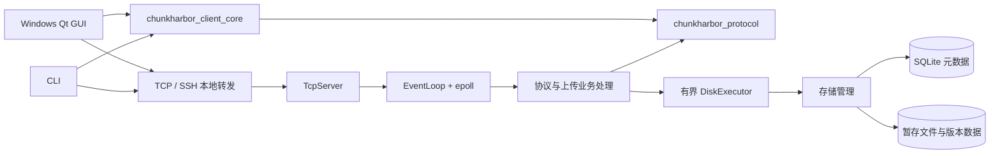
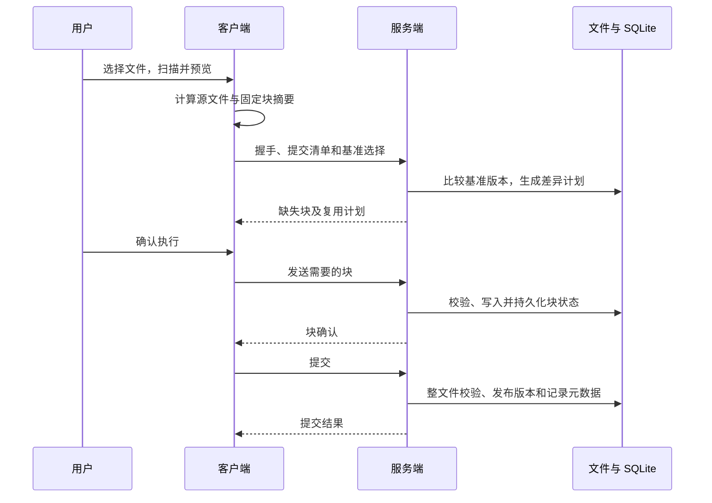
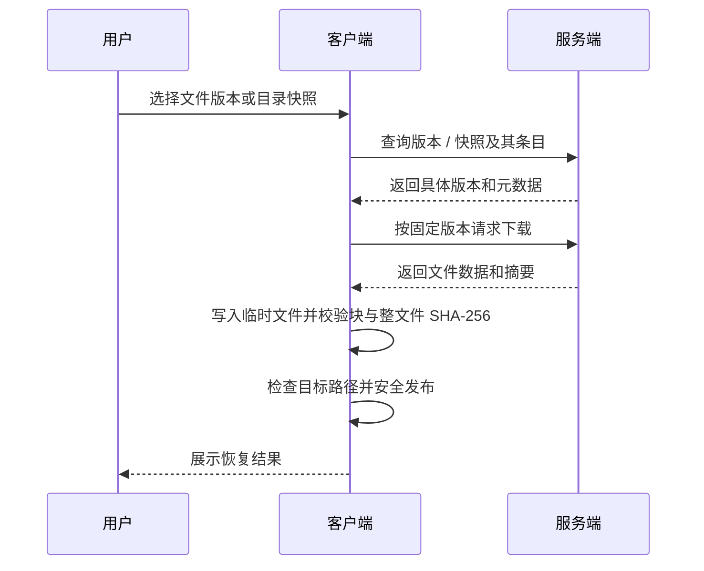

# ChunkHarbor

**基于 C++17、Qt 与 Linux Reactor 的跨平台增量文件备份与版本恢复系统**

ChunkHarbor 面向将本地文件备份到独立 Linux 主机的场景，提供文件选择、差异预览、分块上传和恢复。Windows Qt 图形客户端适合日常操作，CLI 可用于命令行和自动化；服务端使用自主实现的非阻塞 TCP 网络层和文件存储。

系统通过跨平台二进制协议交换备份计划与文件数据。它以固定位置的块摘要减少重复传输，使用持久化会话恢复中断的上传，并通过文件版本和目录快照提供恢复入口。备份方向为客户端到服务端；下载用于恢复数据。

## 核心功能

- **灵活备份**：选择单个文件、多个文件或递归目录，通过包含和排除规则筛选内容。本地映射根决定相对路径，远端前缀构成服务器上的逻辑路径。自动备份策略按文件选择首次上传、增量、有效会话续传或无变化跳过，也可手动选择模式。
- **增量传输**：客户端计算文件和固定块 SHA-256，服务端将块清单与基准版本同位置的块比较，生成缺失块计划并复用匹配的数据。无变化文件可跳过数据上传，避免创建重复版本。
- **断点续传**：客户端保存会话检查点，服务端持久化上传状态和已确认块。重新连接后核对源文件、会话和基准版本，查询缺失部分并继续；服务端启动时也会检查和恢复持久状态。
- **完整性与安全发布**：传输时校验块摘要，提交时校验整文件；数据先写入暂存空间，再协调文件发布与元数据更新。服务端限制逻辑路径并防范路径穿越和符号链接逃逸；下载使用临时文件、校验后发布，拒绝不安全覆盖。中断或取消可保留可续传状态。
- **版本与恢复**：浏览服务端当前文件及历史版本，下载当前文件或指定版本；创建和查询目录快照，并按快照恢复文件夹。恢复时绑定具体版本，下载完成后验证内容。
- **图形界面**：展示扫描结果、差异预览、备份任务、进度和错误，提供文件、版本、快照、日志及设置页面。支持直接 TCP 和由 Windows OpenSSH 客户端管理的 SSH 本地转发。

## 系统架构



GUI 和 CLI 使用共享业务代码及协议编码，分别通过平台网络适配连接服务端。服务端网络层负责连接与事件派发，业务处理将磁盘和数据库工作交给有界执行器，再将结果投递回事件循环。SQLite 保存会话、版本和快照等元数据，文件内容存储在服务端备份根目录下。

## 核心模块设计

### Linux Reactor 网络层

`TcpServer` 接受非阻塞连接并管理连接集合；`EventLoop` 驱动事件分发，`EpollPoller` 封装 epoll，`Channel` 将文件描述符事件关联到回调。`TcpConnection` 管理连接生命周期和输入、输出缓冲，处理 TCP 的半包、粘包和部分写入，并通过缓冲限制和读写控制处理背压。当前服务端使用单个网络 EventLoop；磁盘任务由有界工作池执行，不能将其理解为多 Reactor 网络线程池。

### 网络协议层

`chunkharbor_protocol` 定义与 Qt 和平台 socket 解耦的二进制帧及消息编解码，使用明确的字节序和长度处理 TCP 字节流。握手协商协议版本和能力；请求通过标识符匹配响应，错误消息用于传递业务失败。控制消息与文件块消息分别承载会话、清单、计划、数据及恢复操作。

### 客户端业务层

`chunkharbor_client_core` 负责目录扫描、源文件快照、块清单和增量交换等逻辑。GUI 将选择与路径映射、任务状态和界面展示分开；备份扫描、哈希和传输由工作线程执行，结果通过 Qt 信号传回界面。`QTcpSocket` 在所属线程内使用，界面模型负责呈现任务与服务端文件信息。

### 服务端存储层

上传会话使用暂存文件和 SQLite 状态记录块接收情况。块校验、写入及约定的持久化和元数据更新完成后才返回持久确认；提交前还会核对整文件。已提交内容形成不可变版本对象，当前版本指针指向最新版本，目录快照记录恢复所需的版本引用。

文件系统发布与 SQLite 事务是不同的持久化边界，并非一个跨存储原子事务。实现通过同步、发布状态、准备记录及启动恢复协调异常窗口；无法安全确认的数据不会作为成功结果发布。

## 关键工作流程

### 增量备份与续传



预览与执行会重新检查相关状态，实际执行不会盲目信任过期预览。上传中断后，客户端从检查点取得会话标识，核验源文件与基准，并向服务端查询会话阶段和缺失块；已确认的块不再发送。若会话或源文件不匹配，则不能把它当作有效续传。最终仍需通过整文件校验和提交。

### 历史版本与目录恢复



目录恢复依照快照条目逐文件处理，避免在恢复过程中将随后变化的当前版本误当成快照内容。

## 技术栈

| 类别 | 实现 |
| --- | --- |
| 语言与平台 | C++17、Windows、Linux |
| 服务端网络 | Linux epoll、非阻塞 TCP、eventfd |
| 图形与网络 | Qt 6 Widgets、Qt Network |
| 元数据 | SQLite |
| 摘要 | SHA-256：Linux 使用 OpenSSL；Qt 客户端使用 QCryptographicHash |
| 并发 | EventLoop、有界磁盘工作池、Qt 线程与信号槽 |
| 构建 | CMake 3.20+ |

## 项目结构

```text
ChunkHarbor/
├── apps/
│   ├── server/       # 服务端入口与业务处理
│   ├── cli/          # 命令行客户端
│   └── gui/          # Qt 界面、传输与恢复控制
├── include/chunkharbor/ # 公共模块接口
├── src/
│   ├── net/          # Reactor、连接与缓冲
│   ├── concurrency/  # 有界磁盘任务执行器
│   ├── protocol/     # 协议帧与消息编解码
│   ├── client_core/  # 扫描、备份计划与交换
│   ├── storage/      # 文件存储、会话、版本与 SQLite
│   └── common/       # 日志与摘要工具
├── configs/          # 配置示例
├── docs/             # 设计与使用文档
├── tests/            # 单元与集成测试
└── CMakeLists.txt
```

## 设计特点与适用边界

- GUI、客户端业务和跨平台协议分层，Linux Reactor 不依赖 Qt；网络事件与磁盘工作分离。
- 固定索引块比较适合局部内容修改；文件前部插入内容可能导致后续块错位，不能等同于 rolling checksum 或 rsync。
- 版本对象和目录快照支持按明确版本恢复；历史数据会占用空间，当前没有历史版本垃圾回收或总空间配额。
- 单文件大小受客户端和服务端版本、能力协商及接口限制；旧上传接口上限为 64 MiB。块数和服务端容量准入也有限制。
- 当前传输按块请求和确认，服务端网络使用单 EventLoop；并发能力受连接、工作队列和存储资源限制。
- 系统是单向备份与恢复，不提供双向实时同步。协议本身没有 TLS 或用户身份认证；默认服务端监听回环地址，跨主机使用时应通过可信 SSH 隧道，避免将普通 TCP 端口暴露到不可信网络。

构建和操作细节可参考 [Windows 构建说明](docs/BUILD_WINDOWS.md)、[连接说明](docs/R2_6_CONNECTIONS.md)及[协议说明](docs/PROTOCOL.md)。
